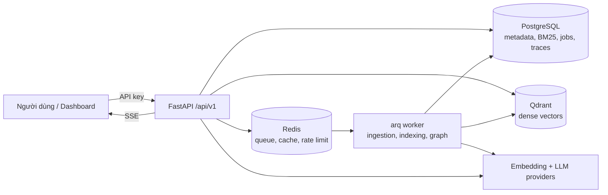

# Architecture Decisions

**Status:** living document. Planned components are labelled; only `DONE`
items have executable evidence.

## 1. System context



## 2. Core decisions

| # | Decision | Rationale | Consequences |
|---|---|---|---|
| D1 | Single backend package `app`, worker package `worker` importing `app` | Shared domain logic without duplicating ingestion/retrieval code | Worker is deployed separately but versioned together |
| D2 | PostgreSQL is the system of record | Transactions for documents, revisions, jobs, traces; BM25 statistics | Qdrant is derived and rebuildable |
| D3 | Workspace-scoped API keys, SHA-256 at rest | Simple machine auth for dashboard/API; no provider lock-in | No per-human SSO; documented limitation |
| D4 | Revision-based ingestion | Reindex idempotently, keep previous good revision, atomic publish | Slightly more schema; clear failure semantics |
| D5 | Explicit BM25 over PostgreSQL term tables | True BM25 with configurable k1/b; avoids mislabelling `ts_rank` as BM25 | More write amplification than FTS; documented |
| D6 | Qdrant single collection with mandatory payload filters | Physical cluster simplicity, deterministic point IDs | Every query must carry workspace/KB/active filters; security tests required |
| D7 | Local multilingual embeddings default (E5-small, 384d) | CPU-friendly, multilingual, permissive license (MIT) | Not state-of-the-art; model upgrade requires reindex |
| D8 | Optional reranker, timeout + fallback | Cross-encoder quality only when budget permits | Quality depends on candidate pool |
| D9 | LLM provider abstraction with explicit "none" | App must start and retrieve without an LLM | Generation endpoints return 503 when unconfigured; never mock |
| D10 | GraphRAG gated and provenance-first | Avoid expensive extraction before baseline proves value | Graph features deferred until hybrid gate |
| D11 | Deterministic routing by default | Agent loops add latency and non-determinism | AUTO policy is rule-based and testable |
| D12 | Citations validated programmatically; support evaluated separately | A resolvable citation can still be unsupported | Evaluation has distinct citation validity and support metrics |
| D13 | Prompt injection treated as data-boundary problem | Instructions alone do not prevent injection | Source text is delimited, labelled untrusted, never executed; tests included |
| D14 | Trace stores bounded, owner-scoped excerpts | Explainability without unbounded sensitive retention | Trace access is authz-checked; logs never include document text |

## 3. Retrieval pipeline (target)

```
query
  → normalize (NFC, diacritics preserved, acronym expansion)
  → [optional bounded rewrite]
  → dense top-k (Qdrant, filtered)
  → sparse top-k (BM25)
  → RRF fusion
  → [optional cross-encoder rerank]
  → dedupe + parent expansion + token-budget packing
  → evidence sufficiency check
  → grounded generation
  → citation marker validation
  → answer or abstention
```

Each stage is independently switchable; the retrieval inspector persists
candidate counts, ranks, score changes, selected context hashes, timings, and
token usage.

## 4. Ingestion pipeline

```
UPLOADED → VALIDATING → PARSING → CHUNKING → EMBEDDING → INDEXING → READY
                                                    ↘ FAILED / CANCELLED
```

- Content-addressed duplicate detection (`SHA-256`).
- Immutable revisions; new revision indexed inactive, then published in one
  transaction, then old Qdrant points removed.
- Failure compensation removes partial vectors and marks a revision failed.
- A failed latest attempt never reports the document as `ready`; if a previous
  revision exists, it remains the active searchable version and the UI labels
  the failed latest attempt.

## 5. Security model

- Every data endpoint requires a bearer API key mapped to exactly one workspace.
- KB/document/job/trace/chat reads are filtered by workspace server-side.
- Dense payload filters include `workspace_id`, `knowledge_base_id`, `active`,
  and `embedding_model`.
- URL ingestion resolves and rejects private, loopback, link-local, and
  metadata addresses, validates every redirect, and enforces size/time limits.
- Uploads validate extension, declared MIME, and magic bytes.
- Cache keys include workspace, KB, index revision, model, and retrieval config.
- Retrieved documents are untrusted data, never instructions.

## 6. Known architectural limitations

- OCR is not implemented in the baseline; scanned PDFs fail loudly.
- BM25 term tables scale linearly in postings; a dedicated search engine is a
  future option, not a default.
- Single-region deployment; no HA claim.
- API-key auth is sufficient for this scope but not enterprise SSO.
- Graph extraction depends on an LLM and is therefore gated and optional.

## 7. Related ADRs

- `docs/adr/0001-monorepo-and-runtime.md`
- `docs/adr/0002-sparse-retrieval-bm25.md`
- `docs/adr/0003-authentication-and-isolation.md`
- `docs/adr/0004-embedding-model-lifecycle.md`
- `docs/adr/0005-graphrag-gate.md`
- `docs/adr/0006-evaluation-methodology.md`
